# Swadharma

B2C astrology consultation app: sign up with OTP, create a birth-details profile, browse astrologers, and consult them over real-time **chat**, **voice** and **video**.

- `lib/` – Flutter app (Riverpod, go_router, Dio, WebSocket, Agora RTC)
- `server/` – demo backend in Dart (REST + WebSocket) and a browser **astrologer console**

## Screenshots

| Login | Sign up | OTP |
|---|---|---|
| 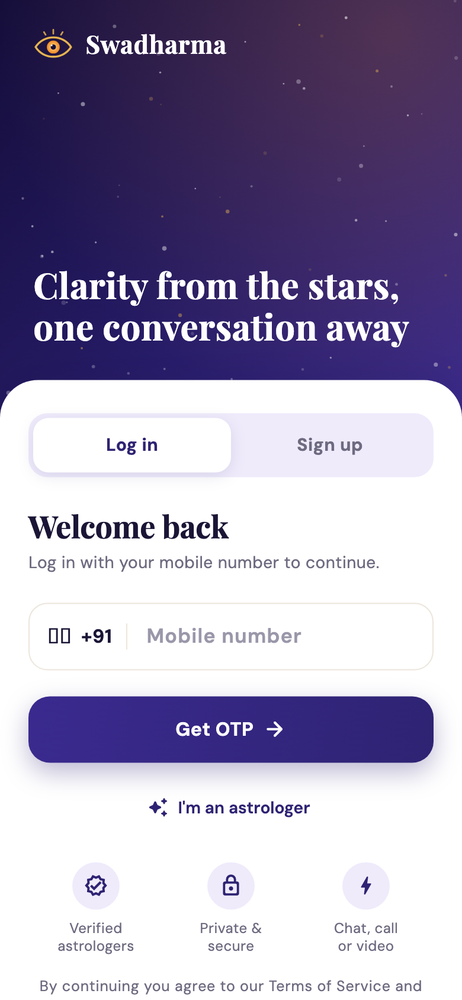 | 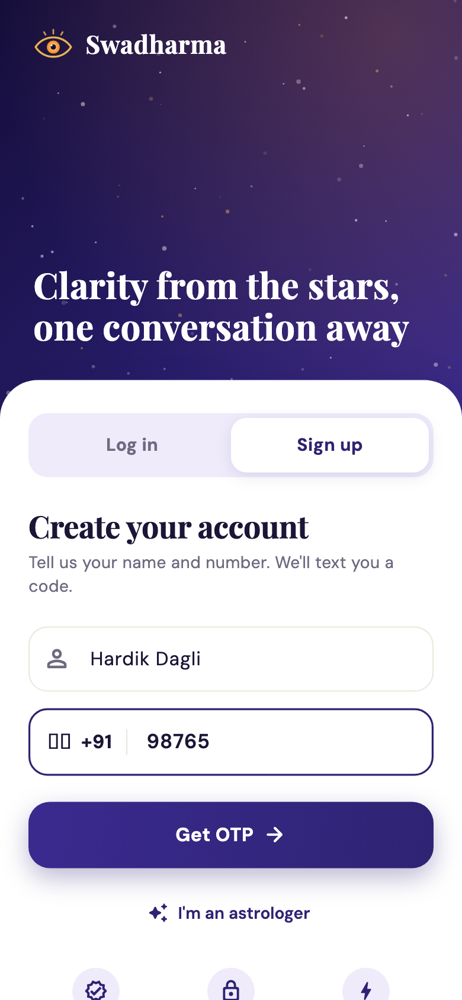 | 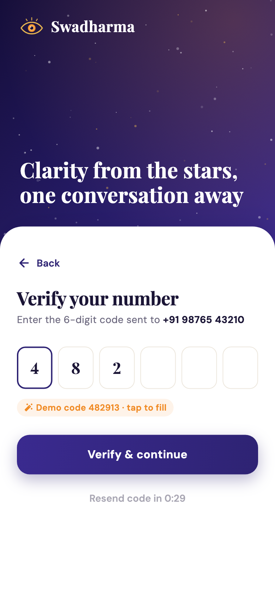 |

| Astrologers | Profile | Waiting |
|---|---|---|
| 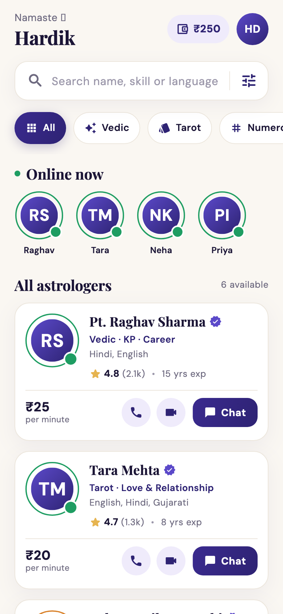 | 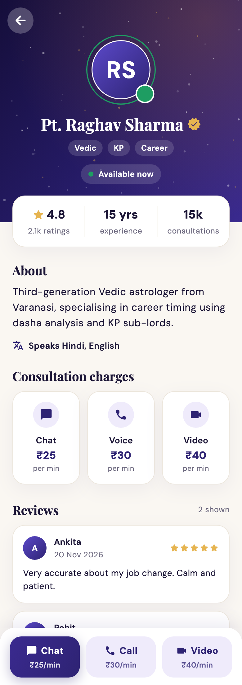 | 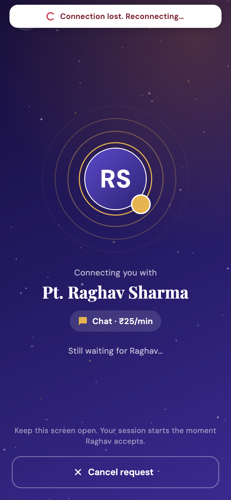 |

| Chat | Summary | History |
|---|---|---|
| 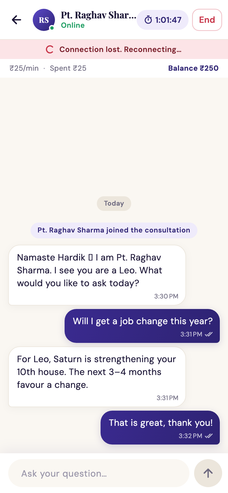 | 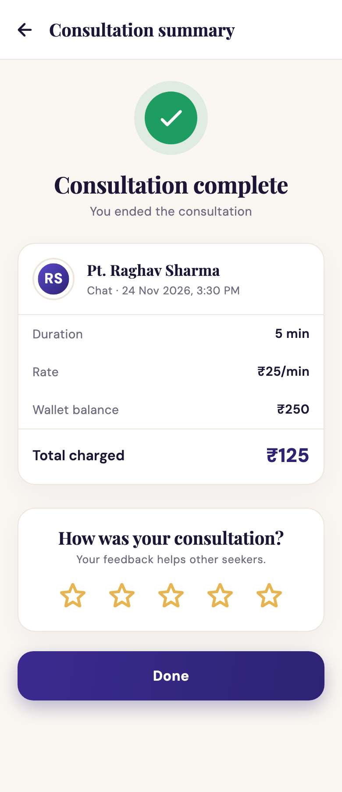 | 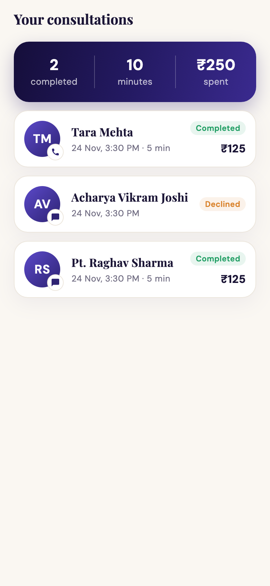 |

| Wallet | Add money | Low balance |
|---|---|---|
| 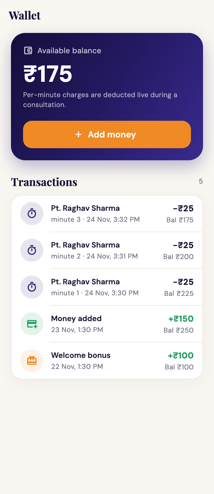 | 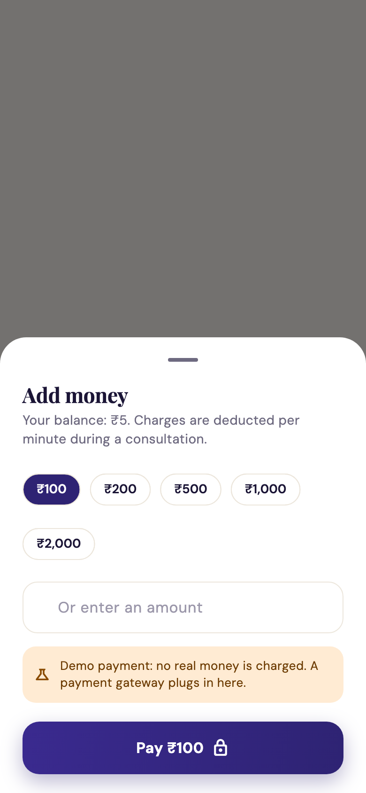 | 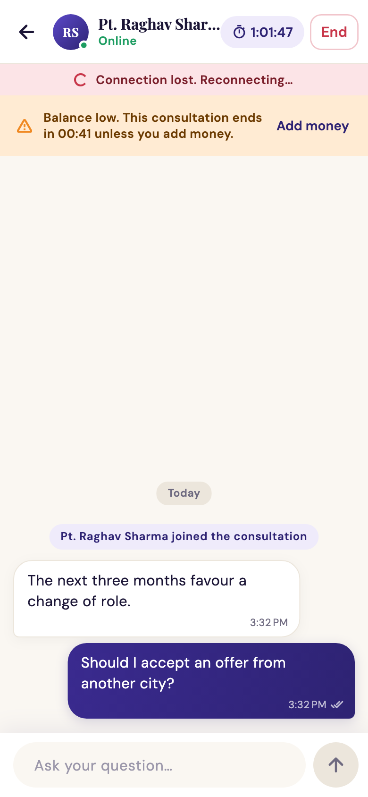 |

### Astrologer app (same codebase, separate login)

| Sign in | Requests | Incoming request |
|---|---|---|
| 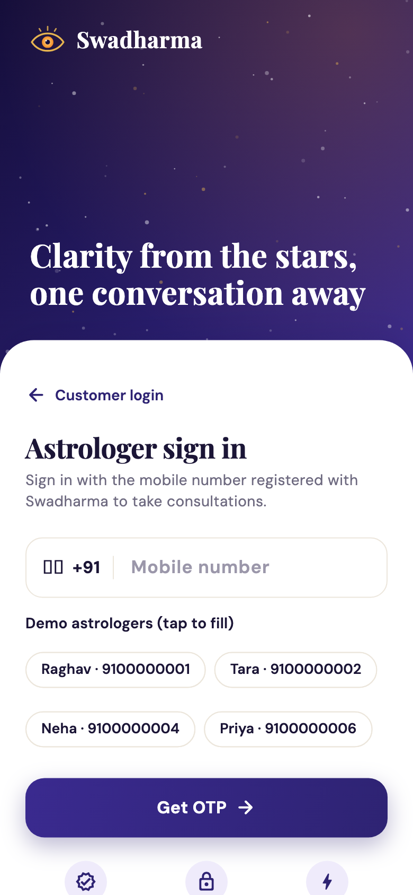 | 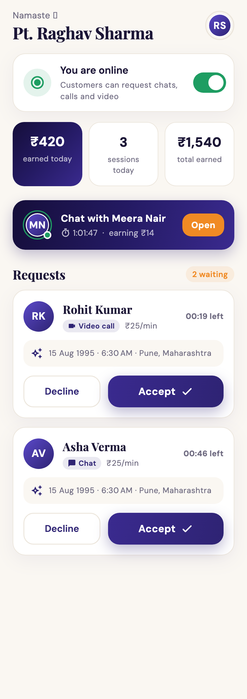 | 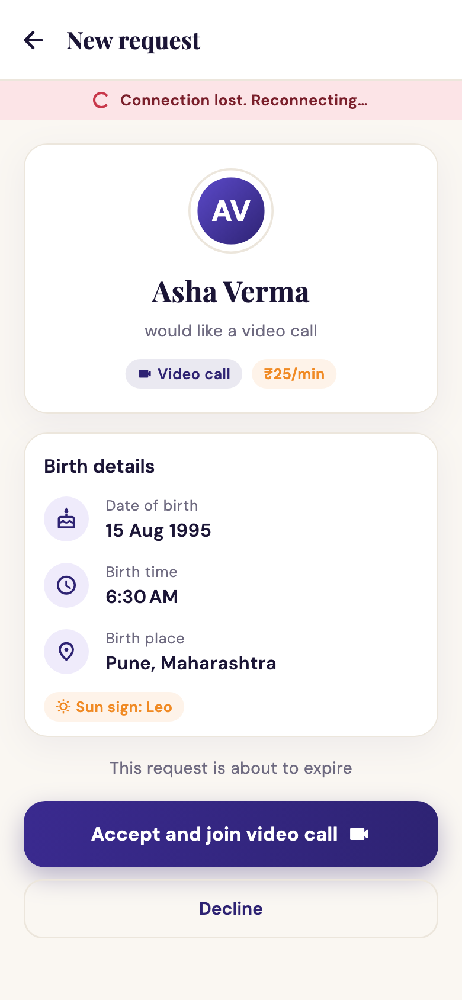 |

| Chat | Earnings | Profile |
|---|---|---|
| 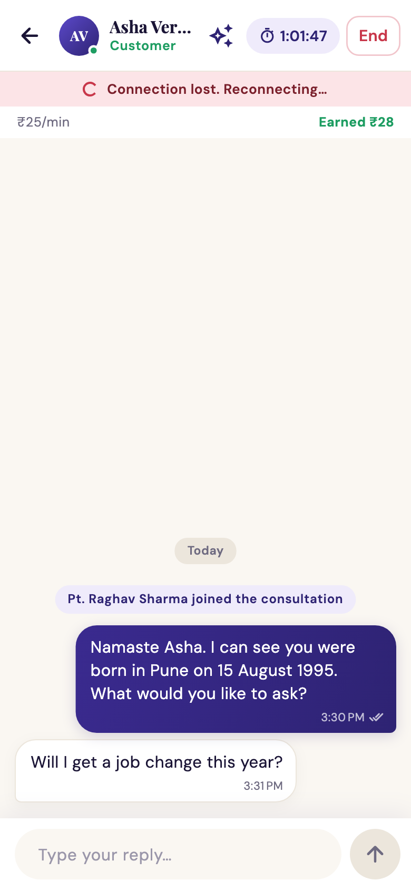 | 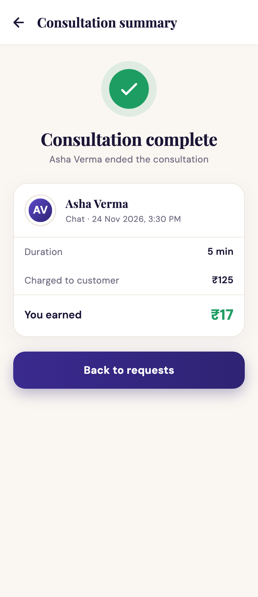 | 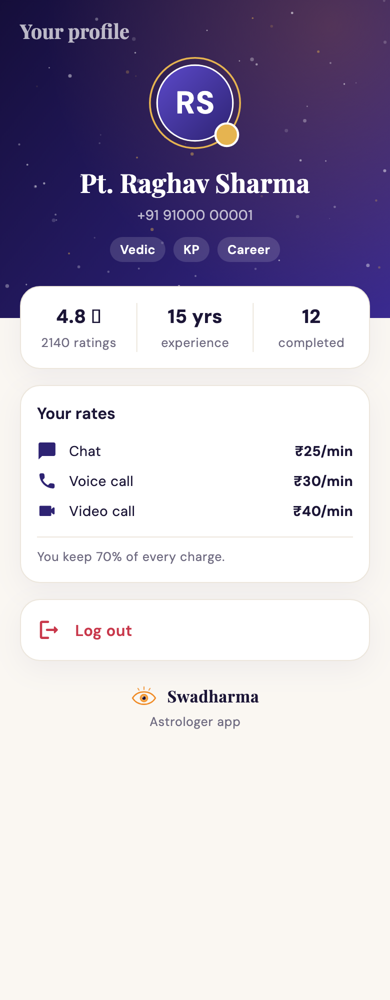 |

(Rendered from the real widgets by `flutter test --update-goldens test/golden`; photos load from the network in the running app, so the images show initials.)

## Run it

### 1. Backend

```bash
cd server
dart pub get
AGORA_APP_ID=<your-agora-app-id> dart run bin/server.dart
```

| Env var | Purpose |
|---|---|
| `AGORA_APP_ID` | Agora App ID. Without it chat works and calls are disabled. |
| `AGORA_TOKEN` | A temporary token from the Agora console ("Generate temp token", valid 24 h). Every call then uses that token's channel, **one call at a time**. A demo stop-gap for a secured project when you can't or don't want to share the certificate. Generate it with *no user id* so two people can join. |
| `AGORA_APP_CERTIFICATE` | Needed if the Agora project has its **App Certificate enabled** ("secured mode"). The server then signs a join token per call. Leave unset for a **testing-mode** project (App ID only). Joining a secured project without it fails with `CAN_NOT_GET_GATEWAY_SERVER ... dynamic use static key`. |
| `PORT` | default `8787` |
| `DATA_FILE` | JSON persistence, default `data/db.json` (`""` = memory only) |
| `DEV_MODE` | `false` stops returning the OTP in API responses |
| `FIREBASE_PROJECT_ID` | enables Firebase phone login (real SMS) and disables the demo OTP |

Console for the astrologer side: <http://localhost:8787/console>

### 2. App

```bash
flutter pub get
flutter run                                   # Android emulator → 10.0.2.2:8787, iOS simulator → localhost:8787
flutter run --dart-define=API_BASE_URL=http://<your-mac-ip>:8787   # physical device
```

Builds: `flutter build apk --debug`, `flutter build ios --simulator --debug`.

## Real SMS login with Firebase (optional)

By default the server uses a **demo OTP** (shown on screen). To send real SMS codes with Firebase Phone Auth:

1. **Firebase console**: create a project, then *Authentication → Sign-in method → Phone → Enable*. Under *Phone numbers for testing* add a number and code (free, no SMS sent).
2. **Android**: add an Android app with package `com.astro.astro_connect`. Add your debug **SHA-1 and SHA-256** (`cd android && ./gradlew signingReport`). Download `google-services.json` into `android/app/`.
3. **iOS**: add an iOS app with bundle id `com.astro.astroConnect`. Download `GoogleService-Info.plist`, drag it into the Runner folder in Xcode and tick the *Runner* target. Then add a URL type in *Runner → Info → URL Types* whose scheme is your `GOOGLE_APP_ID` from that file with `:` replaced by `-` and prefixed `app-` (for example `1:123:ios:abc` becomes `app-1-123-ios-abc`). On real devices also upload an APNs key in Firebase *Project settings → Cloud Messaging*.

   **These two config files are listed in `.gitignore` and are never committed.** Without them the app builds and runs in demo mode.
4. **Server**: start it with your project id, e.g. `FIREBASE_PROJECT_ID=my-project dart run bin/server.dart`. This turns the demo OTP off and makes the server verify Firebase ID tokens.
5. **Rebuild the app** (full stop and `flutter run`; a hot reload won't pick up the native config).

How it works: the app asks the server `/config` which mode is on, checks the number against the server (`/auth/check-phone`) *before* any SMS is sent, lets Firebase text and verify the code, then sends the resulting Firebase ID token to `/auth/firebase`. The server verifies the token's signature, project, expiry and phone number, and returns its own session token. Without the config files the app still builds and runs in demo mode.

## What's in it

**Customer app**
- Sign up / log in with OTP (demo OTP, or real SMS through Firebase), birth-details profile
- Astrologer list with search, filters, live online status; detail pages with reviews
- Chat, voice and video consultations (Agora for calls, WebSocket for chat)
- **Wallet:** ₹100 welcome bonus, simulated top-ups, **per-minute billing** (first minute on acceptance, then each started minute), live balance over the WebSocket, a low-balance warning with countdown, and automatic end when money runs out
- Waiting / ongoing / completed states, history, ratings

**Astrologer app** (log in with *I'm an astrologer*)
- Availability switch, live incoming requests with the customer's birth details and Accept / Decline
- Chat, voice and video from the astrologer's side, session timer, earnings per consultation (70% share), history and totals

## Try the two-sided demo

Run the server in demo mode, then the app on two devices:

1. **Phone A (customer):** Sign up with any number; the code is shown on screen. Open an astrologer and tap Chat, Call or Video.
2. **Phone B (astrologer):** *I'm an astrologer*, then tap a demo number (`9100000001` Pt. Raghav Sharma, `9100000002` Tara Mehta, `9100000004` Neha Kapoor, `9100000006` Priya Iyer). Accept the request that pops up.
3. Chat or talk. Watch the customer's balance tick down each minute, then end the session and see the earnings on the astrologer side.

Without a person on the other side, chat is answered by a simple bot and calls are not offered (the app suggests chat instead). The browser console (`/console`) is the older single-person alternative.

> **Sending this to someone else?** See [DEPLOY.md](DEPLOY.md): host the server online and build one APK that works anywhere.

## Running on a real phone

`localhost` on a phone is the phone itself, so the app needs your computer's address. Either run with
`--dart-define=API_BASE_URL=http://<your-mac-ip>:8787`, or simply open the app and tap **Server: …** at the
bottom of the login screen, type the address (for example `192.168.1.20`) and use **Test connection**.
It is remembered. The phone's **Wi-Fi must be on**, on the same network as the computer: mobile data can't reach a computer's local address. Over USB on Android you can skip Wi-Fi: `adb reverse tcp:8787 tcp:8787`, then use `http://localhost:8787`.

## Demo journey

1. **Sign up** with any 10-digit number (6–9 first digit). In demo mode the OTP is shown on screen (tap to fill); with Firebase you get a real SMS.
2. Fill in name, date/time/place of birth.
3. Pick an **online** astrologer, then Chat / Call / Video.
4. Without the console open, a bot accepts after ~4 s and replies in chat. To act as the astrologer yourself, open the console, choose that astrologer and keep it connected: requests then wait for you to accept, and you can chat or join the call in the browser.
5. End the session, rate it, and find it under **History**.

## Architecture

```
lib/
  core/        config, network (Dio + reconnecting WebSocket), router, theme, shared widgets
  features/
    auth/          OTP login/sign-up, session restore
    profile/       birth details form, profile screen
    astrologers/   list, search/filters, detail, live presence
    consultation/  session lifecycle, chat, Agora calls, history
    home/          bottom-nav shell + "rejoin active session" banner
```

- **State**: Riverpod `Notifier`/`AsyncNotifier`; repositories are providers so tests override them.
- **Routing**: go_router with an auth/profile redirect guard.
- **Realtime**: one app-wide WebSocket with backoff reconnect; on reconnect the consultation and presence state resync from REST.
- **Session states**: `requested → ongoing → completed`, or `rejected / cancelled / missed`. The server owns the clock; clients correct for clock skew. Billing is per started minute.
- **Errors**: all failures become `AppException` with a user-readable message; failed chat messages can be retried; a call that can't connect or drops ends with an explained reason.

## Tests

```bash
flutter test          # app (widget, controller, golden/smoke)
cd server && dart test

# Contract test: the app's real models and API client against a live server
cd server && PORT=8788 DATA_FILE="" AGORA_APP_ID=demo dart run bin/server.dart &
LIVE_SERVER=http://localhost:8788 flutter test test/contract
```

## Notes / limits

- The backend is a demo: in-memory + JSON file, OTP shown in the response, no SMS, no payments, unauthenticated astrologer console.
- Calls support both Agora modes: App-ID-only (testing) and signed tokens (set `AGORA_APP_CERTIFICATE`; the server issues a 4-hour token per call, using the v006 token format). The certificate never leaves the server.
- Android `compileSdk` is forced to 37 because the Agora and permission plugins require it.

## Design

- **Palette:** deep indigo "night sky", saffron and gold accents, warm ivory canvas (`lib/core/theme/app_colors.dart`).
- **Type:** Playfair Display for headings and names, DM Sans for everything else (both SIL Open Font License, bundled in `assets/fonts/`). Numbers and prices always use DM Sans.
- **Brand:** the product name and tagline live in `lib/core/brand/brand.dart` (`AppBrand`); the third-eye mark is drawn in code, so it scales without image assets.
- `flutter test --update-goldens test/golden` regenerates the screenshots in `test/golden/out/`.
